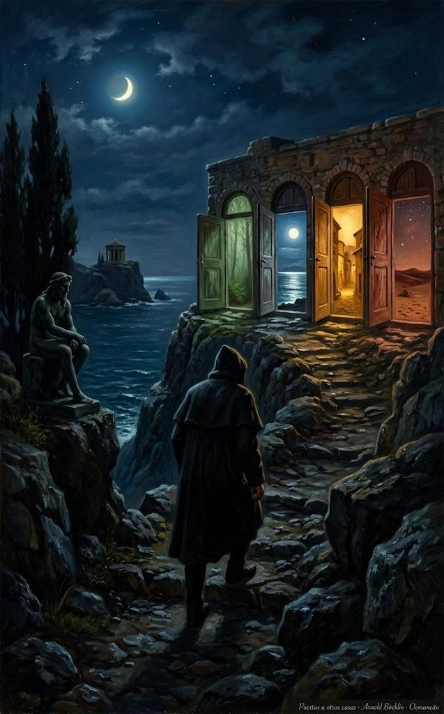

30 de octubre de 2026

# Las puertas de Warren Ellis

Warren Ellis es un escritor inglés —novelas, cómics, guiones— que envía cada semana una carta por correo, *Orbital Operations*, y lleva además un diario breve en su página, warrenellis.ltd. Esta selección reúne lo rescatado de cuarenta y ocho de esas cartas y seis notas de diario, publicadas entre julio de 2025 y octubre de 2026.

Lo valioso de Ellis no es su vida ni su trabajo, sino su antena: tiene el oído puesto en una cultura que no pasa por la corriente principal, y casi cada carta trae una página, un disco o una voz que uno no habría encontrado solo. Esto es lo que quedó de ese barrido: las puertas, con lo que hay detrás de cada una. No está su obra, ni sus asuntos, ni los anuncios que la carta llevaba pegados.

## Música que no llega por el algoritmo

Pitchfork publicó este año una guía para [buscar música sin Spotify](https://pitchfork.com/thepitch/how-to-dig-for-music-without-spotify/): la tesis es que lo mejor no llega solo, hay que salir a buscarlo. Ellis la practica desde siempre. Casi cada carta trae uno o dos discos de Bandcamp —una tienda en línea donde los músicos venden su obra directamente— y muchos vienen de una misma esquina del mundo: [Konsztrukting Soundz](https://konsztruktingsoundz.co.uk/), una noche mensual de música experimental en Old Leigh, en la costa inglesa, que él describe como la espina dorsal de su año.

Los discos rescatados:

- [Heinali y Andriana-Yaroslava Saienko, *Гільдеґарда*](https://heinali-yasia.bandcamp.com/album/hildergard): dos músicos ucranianos reescriben los cantos de Hildegard von Bingen, abadesa y compositora del siglo XII, entre sintetizadores y una voz altísima.
- [Laura Cannell, *The Visible Light of Other Worlds*](https://brawlrecords.bandcamp.com/album/the-visible-light-of-other-worlds): violín y grabaciones de campo desde el este de Inglaterra, en su propio sello, Brawl Records.
- [Philip Jeck y Jacob Kirkegaard, *Soaked*](https://philipjeck.bandcamp.com/album/soaked): vinilos gastados y grabaciones de campo, lentos como agua estancada.
- [Rhodri Davies, *Telyn Rawn*](https://rhodridavies.bandcamp.com/album/telyn-rawn): improvisación con arpa galesa.
- [Sunfish Starfish, *The Black Swallower*](https://sunfishstarfish.bandcamp.com/album/the-black-swallower): drone de cámara; Ellis lo oyó en vivo y lo cuenta entre lo mejor que escuchó en Konsztrukting Soundz. El *drone* es un estilo de notas largas y sostenidas, más paisaje que canción.
- [Barn Hoppit, «Cantigua 100»](https://barnhoppit.bandcamp.com/track/cantigua-100): en sus palabras, música medieval encantada en su mejor forma.
- [Sunn O)))](https://sunn.bandcamp.com/album/sunn-o-2): el peso del mundo hecho guitarra.
- [Stephen O'Malley, *Spheres Collapser*](https://stephenomalley.bandcamp.com/album/spheres-collapser): la mitad de Sunn O))) a solas.
- [Julianna Barwick y Mary Lattimore, *Tragic Magic*](https://juliannabarwick.bandcamp.com/album/tragic-magic): voces en capas y arpa.
- [Keith Berry, *Ichigo Ichie*](https://keithberry.bandcamp.com/album/ichigo-ichie): ambient sereno; el título es una idea japonesa de la ceremonia del té — cada encuentro ocurre una sola vez. El *ambient* es música de ambiente, hecha para rodear.
- [Natalie Beridze, *If We Could Hear*](https://natalieberidzetba.bandcamp.com/album/if-we-could-hear): electrónica desde Tiflis.
- [Abul Mogard y Rafael Anton Irisarri, «In a Quiet Radiance»](https://irisarri.bandcamp.com/track/in-a-quiet-radiance-feat-andrea-burelli-martina-bertoni): una pieza larga y luminosa con dos voces de cuerda.
- [Alison Cotton, *The Gods Laugh*](https://alisoncotton-uk.bandcamp.com/album/the-gods-laugh): viola y voz en capas densas.
- [Zola Jesus, *Saint Clare*](https://zolajesus.bandcamp.com/album/saint-clare-original-score-2): una banda sonora oscura y coral.
- [The Owl Service](https://theowlservice.bandcamp.com/): folk inglés de raíz; Ellis salió del concierto con media mesa de discos comprada.
- [Zoharum](https://zoharum.bandcamp.com/): un sello experimental polaco que le manda paquetes de discos cada tanto; todo su catálogo se escucha gratis. Su favorito: [«Bielu Datura», de HVAST](https://zoharum.bandcamp.com/track/bielu-datura).
- [Kali Malone elige sus discos favoritos](https://thequietus.com/interviews/bakers-dozen/kali-malone-favourite-albums-interview-burning-song/): la organista sueca repasa los trece álbumes que la formaron, en The Quietus.

Para seguir oyendo: los [mixtapes de door.link](https://www.door.link/mixtapes/210), que cambian cada semana y siempre sorprenden; el programa de radio [Anti-Authoritarian ASMR, de Angela Winter](https://www.mixcloud.com/camp_fr/), y un mapa entero de podcasts de música ambiental que Ellis soltó una vez de corrido: [Hypnagogue](https://hypnagoguepodcast.com/), [Ambient Soundbath](https://www.ambientsoundbath.com/), [Desert Oracle Radio](http://desertoracle.com/radio) y [Psychedelic Salon](https://psychedelicsalon.com/) entre ellos.

## Voces que escriben en casa propia

- [8Ball, de Sean Monahan](https://www.8ball.report/): el hombre que mide el clima de la cultura antes de que llegue.
- [The Honest Broker, de Ted Gioia](https://www.honest-broker.com/p/the-10-greatest-failures-of-orson): música, medios y oficio; aquí, los diez mayores fracasos de Orson Welles.
- [Where's Your Ed At, de Ed Zitron](https://www.wheresyoured.at/cargo-culture/): el azote más leído de la industria de la inteligencia artificial.
- [Graphomane, de Neal Stephenson](https://nealstephenson.substack.com/p/peter-fleming): el novelista escribiendo sobre el escritor y viajero Peter Fleming.
- [jilltxt, de Jill Walker Rettberg](https://jilltxt.net/three-strategies-for-protecting-human-spaces-from-bots-inspired-by-ai-agent-velvet-vales-email-to-the-aoir-mailing-list/): tres estrategias para proteger los espacios humanos de los bots.
- [Platformer, de Casey Newton](https://www.platformer.news/does-intelligence-need-a-hard-cap/): ¿necesita la inteligencia un techo firme?
- [Today in Tabs, de Rusty Foster](https://www.todayintabs.com/p/desiring-machines): la web del día, contada con oficio.
- [Do Not Research](https://donotresearch.substack.com/p/performing-distress): escritura sobre internet desde dentro; aquí, la angustia como actuación.
- [Nemesis Memos](https://nemesisglobal.substack.com/p/the-end-of-trends): el fin de las tendencias.
- [MØRNING](https://morningfyi.substack.com/p/mrning-presents-hardware-2026): el informe *Hardware 2026*, sobre la alegría de desconectarse y los aparatos que no piden cuenta.
- [charli xcx](https://itscharlibb.substack.com/p/the-realities-of-being-a-pop-star): la cantante cuenta, en su propia carta, lo que cuesta ser una estrella pop.
- [Frequency Range, de Brian Ekberg](https://freqrange.substack.com/), [Raven Belasco](https://ravenbelas.co/), con su carta [Update from the Am'r Archives](https://ancientscrolls.beehiiv.com/), [Rain DeGrey](https://raindegrey.substack.com/) y [404EVER, de Lordess Foudre](https://404ever.substack.com/): cuatro voces que Ellis enlaza semana tras semana.

## Mapas de la otra web

- [Hermitary](https://hermitary.com/around/?p=2873): un sitio entero dedicado a los ermitaños, su historia y sus libros. El enlace concreto cuenta a Hannah Hauxwell, que vivió sola en una granja de los Peninos durante décadas.
- [ooh.directory](https://ooh.directory/updated/): un directorio de blogs que se actualizan, para descubrir fuentes sin algoritmo.
- [Blogs Are Back](https://www.blogsareback.com/): otro directorio de blogs independientes, con el mismo propósito.
- [Tiny Awards](https://tinyawards.net/): premios anuales a la web pequeña y hecha a mano.
- [Dark Forest OS](https://www.dfos.com/): una propuesta para que los grupos creen mundos privados propios, lejos de la web abierta y sus raspadores.
- [A-Side](https://www.a-side.social/): grupos privados para compartir fotos y mensajes cifrados.
- [Stowaway](https://stowaway.live/): un rastreador de vuelos que enseña lo que se ve desde la ventanilla — el cielo real, la hora real, las estrellas de esta noche.
- [Moltbook](https://www.moltbook.com/): un foro donde solo pueden publicar agentes de inteligencia artificial; las personas solo leen.
- [Zine Stuff](https://zinestuff.blogspot.com/p/free-zines.html): fanzines gratis para imprimir en casa.
- [The Modernist](https://the-modernist.org/collections/the-modernist-magazine): una revista sobre arquitectura modernista. Dato rescatado: la silla plástica de una pieza que está en todas partes tiene nombre — Monobloc.
- [Housmans](https://housmans.com/): la librería radical de Londres, con el mayor fondo de revistas y panfletos de Gran Bretaña.
- [Sputnik1957](https://sputnik1957s.com/): relojeros ucranianos que restauran relojes soviéticos de los años cincuenta.
- [Halupedia](https://halupedia.com/): una enciclopedia escrita por completo con alucinaciones de inteligencia artificial.
- [The Periodic Table of Factory Records](https://www.factoryrecords.org/periodic-table-of-factory-records.php): el catálogo completo del sello de Manchester ordenado como tabla periódica — cada producción tuvo su número FAC, y el último se reservó para el ataúd de un fundador.
- [Philip K. Dick Festival](https://www.philipkdickfest.com/): el festival internacional dedicado al escritor.
- [Soeur L'Enfer](https://www.soeurlenfer.com/): el proyecto musical de Nina Courson, con videos de Dan Schaffer.
- [Wyrd Britain](https://wyrdbritain.blogspot.com/2026/10/shadows-over-cymru-uncanny-stories-of.html): un blog de lo raro británico; aquí, cuentos galeses de lo insólito.
- [Calm Technology](https://calmtech.com/): el principio de que la tecnología debe pedir la menor atención posible.
- [Doomscrolling Alternatives](https://www.wellappointeddesk.com/2026/10/doomscrolling-alternatives/): qué hacer con las manos cuando el pulgar pide desplazar la pantalla.

## Arte para mirar despacio

- [Pejac](https://www.thisiscolossal.com/2026/03/pejac-graph-paper-graphite-drawings/): trampantojos dibujados sobre papel cuadriculado común.
- [Aron Wiesenfeld](https://www.thisiscolossal.com/2026/08/aron-wiesenfeld-oil-paintings-narratives/): pinturas de figuras solas en paisajes que traman algo.
- [Janusz Jurek](https://www.thisiscolossal.com/2026/05/janusz-jurek-street-photography/): fotografía callejera de lo raro cotidiano.
- [Elliot McGucken](https://www.thisiscolossal.com/2026/06/elliot-mcgucken-spacetime-light-cone-sculptures-photography-landscapes/): conos de luz suspendidos sobre el desierto.
- [Jan Erik Waider](https://www.thisiscolossal.com/2026/03/jan-erik-waider-baltic-sea-ice-video/): videos hipnóticos del hielo del mar Báltico.
- [Setenta artistas en un hospital vacío](https://www.thisiscolossal.com/2026/06/in-los-angeles-70-artists-transform-a-vacant-hospital/): una instalación que ocupó un hospital entero de Los Ángeles.
- [Andrew McIntosh](https://www.thisiscolossal.com/2026/05/andrew-mcintosh-red-landscape-paintings/): paisajes rojo sangre que dan miedo y calma.
- [Jonathan Knight, *Exhale*](https://www.thisiscolossal.com/2026/10/jonathan-knight-exhale-seascape-photographs/): fotografía meditativa del mar.
- [Robin F. Williams](https://www.thisiscolossal.com/2026/10/robin-f-williams-paintings-act-natural/): la tecnología pintada entre el encanto y el horror.
- [Masha Foya](https://www.thisiscolossal.com/2026/04/masha-foya-digital-illustrations/): ilustración ligera sobre las emociones comunes.
- [A. Brady Picture](https://brady-pictures.com/): la fotógrafa cuyas imágenes Ellis enlaza semana tras semana.
- [Creative Boom](https://www.creativeboom.com/insight/is-social-media-over-for-creatives-or-are-we-just-waking-up-to-what-it-is/): ¿se terminaron las redes para los creativos, o por fin se les ve lo que son?

## Libros, cómics y oficio

- [Una conversación larga con Vladimir Sorokin](https://www.theparisreview.org/blog/2025/07/21/the-guts-of-the-russian-brontosaurus-cow-a-conversation-with-vladimir-sorokin/): The Paris Review habla con el novelista ruso; Ellis la amó.
- [Ten Writing Prompts](https://www.theparisreview.org/blog/2026/01/14/ten-writing-prompts/): diez detonantes de escritura, también en The Paris Review.
- [Molly Crabapple, *Here Where We Live Is Our Country*](https://www.penguinrandomhouse.com/books/646320/here-where-we-live-is-our-country-by-molly-crabapple/): la historia del pueblo judío contada por una dibujante.
- [Peter Kuper, *The System*](https://www.peterkuper.com/the-system): una novela gráfica sobre cómo todo se conecta.
- [Ganzeer, *The Solar Grid*](https://thesolargrid.net/): la novela gráfica egipcia de clima y poder.
- [Mia Wolff en Fantagraphics](https://www.fantagraphics.com/collections/mia-wolff): cuatro libros de una dibujante mayor que merece más lectores.
- [Olga Tokarczuk, *House of Day, House of Night*](https://fitzcarraldoeditions.com/books/house-of-day-house-of-night/): la premio Nobel polaca, en Fitzcarraldo.
- [Simon Mason, *Missing Person: Alice*](https://www.hachette.co.uk/titles/simon-mason-11/missing-person-alice/9781529425987/): el primer caso del Finder, un especialista en personas desaparecidas; novelas cortas de crimen que caen entre Simenon y Ballard.
- [Charles Stross, *Accelerando*](https://www.antipope.org/charlie/blog-static/fiction/accelerando/accelerando.html): la novela entera, gratis, en la página del autor.
- [*Ripples from Carcosa*](https://www.hippocampuspress.com/other-authors/nonfiction/ripples-from-carcosa-h.-p.-lovecraft-haunted-landscapes-and-true-detective): Lovecraft, los paisajes embrujados y True Detective.
- [*Hollywood Haunts the World*](https://headpress.com/product/hollywood-haunts-the-world/): cine y lo oculto, de Headpress.
- [*New World Order 2025*](https://comatter.metalabel.com/new-world-order?variantId=1): un informe de 35 páginas sobre qué pasa cuando chocan el poder, la infraestructura y la ideología.
- [I/O](https://io-podcast.com/about/): un podcast de ficción sonora.

## Cine y tele

- [Max Headroom, la serie completa](https://archive.org/details/max-headroom-complete/): los ochenta entera, en el Internet Archive — la biblioteca pública en línea que lo guarda todo.
- [*Surrealism (and Dada)*, 1971](https://rarefilmm.com/2025/12/surrealism-and-dada-1971/): un documental raro y pequeño, rescatado por la Cueva de las Películas Olvidadas.
- [Las mejores escenas de acción de 2025](https://mubi.com/en/notebook/posts/the-best-action-scenes-of-2025): el cuaderno de MUBI, el servicio de cine de autor por suscripción.
- [*The Mandela Catalogue* llega al cine](https://www.worldofreel.com/blog/2026/7/2/the-mandela-catalogue-spielberg-stuber): del horror hecho en YouTube a Amazon.
- [*Cooking Price-Wise*](https://www.cineoutsider.com/reviews/bluray/c/cooking_price-wise_br.html): Vincent Price enseñando a cocinar en la televisión británica de 1971.

## Ciencia y rarezas

- [El juramento de sangre de yeti](https://www.pillarcatholic.com/p/yeti-blood-oath-divides-denver-seminary): el escándalo real de un seminario de Denver.
- [*Histoires Prodigieuses*](https://publicdomainreview.org/collection/histoires-prodigieuses/): el manuscrito de monstruos y prodigios que copió para sí Isabel I, en The Public Domain Review.
- [Ecolocalizar en diez semanas](https://www.sciencealert.com/humans-can-echolocate-and-it-changes-the-wiring-of-the-brain): las personas pueden aprender a orientarse por el eco, y el cerebro se recablea.
- [El centro de datos con células cerebrales humanas](https://futurism.com/robots-and-machines/staff-brain-data-center-spine-fluid): hay que cambiarles el líquido cefalorraquídeo a diario.
- [Una antipartícula atrapada durante un mes](https://www.yahoo.com/news/science/articles/physicists-trap-single-antimatter-particle-150000058.html).
- [Los primeros virus diseñados por inteligencia artificial](https://www.theguardian.com/science/2026/aug/06/safety-fears-as-scientists-make-first-viruses-designed-by-ai), y el miedo que despiertan.
- [Una planta de tabaco modificada para producir cinco psicodélicos](https://phys.org/news/2026-04-tobacco-psychedelics-psilocybin-dmt.html).
- [Los océanos de Neptuno y Urano serían superiónicos](https://phys.org/news/2026-04-depths-neptune-uranus-superionic.html).
- [El buzo que aguantó 29 minutos bajo el agua](https://www.odditycentral.com/news/freediver-holds-breath-underwater-for-29-minutes-shatters-world-record.html).
- [La vida pudo surgir dos veces](https://www.sciencealert.com/radical-study-suggests-life-on-earth-arose-from-non-living-matter-twice).
- [La evolución humana sigue, y se ve en el Tíbet](https://www.sciencealert.com/humans-are-still-evolving-before-our-eyes-on-the-tibetan-plateau).
- [En la Mesopotamia antigua, la diversidad de género tenía títulos y oficios](https://phys.org/news/2026-01-eunuchs-sex-workers-ancient-mesopotamia.html).
- [Los robots humanoides chinos ya corren como Usain Bolt](https://www.odditycentral.com/news/chinas-humanoid-robots-are-now-as-fast-as-usain-bolt.html).

## Papel y objetos

- [La entrevista de Hobonichi](https://www.jetpens.com/blog/Hobonichi-Interview-Hobonichi-s-History-Designs-and-Future/pt/1028): historia, diseño y futuro de la libreta japonesa.
- [Los 47 mejores bolígrafos de 2026](https://www.jetpens.com/blog/The-47-Best-Pens-for-2026-Gel-Ballpoint-Rollerball-and-Fountain-Pens/pt/974), según JetPens.
- [Casio CRW-001](https://www.casio.com/uk/watches/casio/product.CRW-001-1/): un reloj que se lleva como anillo.
- [iKKO MindOne](https://www.dezeen.com/2025/08/15/ikko-mindone-smartphone-technology/): un teléfono pequeño, hecho para pedir poca atención.
- [Cómo hacer cuero de fruta](https://foragerchef.com/how-to-make-fruit-leather/): la fruta silvestre convertida en dulce guardable.

Cuarenta y ocho cartas y seis notas de diario: esto es lo que valía conservar.

Fuentes: [Orbital Operations](https://orbitaloperations.beehiiv.com/) · [warrenellis.ltd](https://warrenellis.ltd/)

© 2026 Osmancito

[volver](../social.html)
